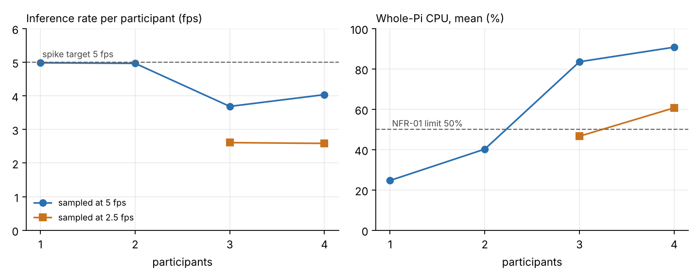

# Technical spike: LiveKit decode, resize and TFLite inference on CPU

IT 444 Capstone, Team 1, Track A (scalable multi-party zero-trust conferencing defense with deepfake detection).

**Spike question:** can LiveKit decode, resize and TFLite inference together sustain at least 5 FPS on CPU only?

**Short answer (Raspberry Pi 4, video only):**

| Participants | Sampling rate per participant | Result |
|---|---|---|
| 1 and 2 | 5 fps | **Pass.** 5.0 fps sustained, no drops, CPU 25% and 40%. |
| 3 | 5 fps | **Fail.** 3.7 fps, dropped frames, CPU 84%. |
| 4 | 5 fps | **Fail.** 4.0 fps, dropped frames, CPU 91%. |
| 3 | 2.5 fps | **Pass.** 2.6 fps, no drops, CPU 47% mean (3 of 12 intervals above 50%). |
| 4 | 2.5 fps | **Fail on CPU.** 2.6 fps and no drops, but CPU 61%. |

FR-02 (at least 1 score per second per participant) was met in every run. NFR-04 (under 70 C) was met in every run (maximum 63.3 C) and the Pi never throttled. Audio inference was not tested.



## Scope and caveats (read before citing these numbers)

- Hardware is a **Raspberry Pi 4** (4 cores, CPU only), standing in for the planned target device. Do not read these numbers as Pi 5 or Jetson numbers.
- The video model is the stock quantized **MobileNetV2 ImageNet classifier** (`mobilenet_v2_1.0_224_quant.tflite`), used only as a **timing stand-in**. Its score is the top ImageNet confidence and says nothing about deepfake detection accuracy.
- Each configuration was run **once for about 2 minutes** (12 ten-second intervals). The runs are evidence of order of magnitude, not statistical confidence.
- Publishers ran on a separate Windows laptop (640x480, 30 fps video, 16 kHz mono audio, one looped clip). The laptop may have limited the 4-participant receive-only run (see below).
- Two inference threads (`--workers 2`, one CPU thread each) were used throughout. Other worker counts were not tried.
- **Audio was not run.** Video alone already exceeded the CPU limit at 3 or more participants at 5 fps, so we did not add an audio model.

## Method

1. LiveKit server 1.13.11 on the Pi in `--dev` mode (key `devkey`, secret `secret`).
2. 1 to 4 publishers (`scripts/publisher.py`), each with a distinct identity, join room `spike`.
3. The subscriber on the Pi (`scripts/receive_bench.py`, then `scripts/receive_infer.py`) samples frames, converts to RGB24, resizes to 224x224 and (in the second script) runs TFLite inference in a small thread pool. Frames are dropped, and counted, when the pool is backed up.
4. Every 10 seconds it logs, per participant: received fps, sampled fps, inference fps, dropped fps, convert+resize ms, model ms (median and p95), mean score, plus whole-Pi CPU (total and per core), temperature and the `vcgencmd get_throttled` flag.

## Results

### 1. Receive path only (no model)

`data/receive_only/`, summarized in `results/receive_only_summary.csv`.

| Participants | Recv fps per stream | Kept fps per stream | CPU mean | Temp max |
|---|---|---|---|---|
| 1 | 25.0 | 4.99 | 12% | 48 C |
| 2 | 25.0 | 4.99 | 19.5% | 48 C |
| 3 | 24.9 | 4.95 | 25.0% | 50 C |
| 4 | 21.6 (min 12.1) | 4.77 | 31.8% | 52 C |

Receive cost grows about 6 to 7 CPU points per participant. The 4-participant run had a transient dip to 12 to 14 fps received on all streams at once while Pi CPU fell, which points to the laptop or network rather than the Pi. That run was not repeated.

### 2. With TFLite video inference

`data/with_inference/`, summarized in `results/summary.csv` and `results/summary.md`.

| Participants | Target fps | Inference fps (mean / min) | Dropped fps | Model ms (median / p95) | CPU mean / max | Intervals over 50% CPU | Temp max |
|---|---|---|---|---|---|---|---|
| 1 | 5 | 4.98 / 4.9 | 0 | 72.5 / 78.6 | 24.7% / 57.4% | 1 of 12 | 51.1 C |
| 2 | 5 | 4.97 / 4.7 | 0 | 84.3 / 101.6 | 40.3% / 45.4% | 0 of 12 | 54.0 C |
| 3 | 5 | 3.69 / 1.7 | 1.11 | 113.7 / 258.9 | 83.6% / 95.0% | 12 of 12 | 59.4 C |
| 4 | 5 | 4.04 / 2.6 | 0.84 | 114.0 / 147.8 | 90.8% / 95.1% | 12 of 12 | 63.3 C |
| 3 | 2.5 | 2.61 / 2.5 | 0.00 | 85.8 / 133.2 | 46.6% / 57.0% | 3 of 12 | 56.4 C |
| 4 | 2.5 | 2.59 / 2.3 | 0.01 | 94.7 / 118.8 | 60.7% / 73.1% | 12 of 12 | 58.9 C |

The first interval of the 1-participant run reached 57% CPU, which looks like model warm-up. Model time rises with load (72 ms alone, about 114 ms at 3 to 4 participants at 5 fps), so the pipeline saturates instead of scaling smoothly. The 3-participant, 5 fps run alternated between healthy intervals and collapsed ones (about 2 fps, 300 ms or more per model call).

## Conclusions

- On a Pi 4, video-only inference at **5 fps per participant is sustainable for 2 participants** within the 50% CPU limit (NFR-01).
- For **3 participants, 2.5 fps per participant** is close to the CPU limit (47% mean). 4 participants exceeds it even at 2.5 fps.
- FR-02 (1 score per second per participant) holds for up to 4 participants.
- Larger rooms need faster hardware, a lighter or better-optimized model, a lower sampling rate, or different frame selection. Audio would add load on top of these numbers.

## Open items

- Rerun the 4-participant receive-only test with a lighter publisher load to separate Pi limits from laptop limits.
- Test the team's actual quantized MobileNetV2 detector and an audio model, then measure fusion cost.
- Repeat runs for variance and try other `--workers` values.
- Repeat on the target device (Pi 5 or Jetson Orin NX).

## Repository layout

```
scripts/      publisher.py, make_tokens.py, list_tracks.py, receive_bench.py, receive_infer.py
data/
  receive_only/            valid receive-path runs (2, 3 and 4 real publishers)
    single_stream_repeats/ runs labelled 1 to 4 that only had ONE publisher (valid single-stream repeats)
  with_inference/          all TFLite runs (5 fps and 2.5 fps)
  excluded/                first benchmark attempt, invalid (see excluded/README.md)
analysis/summarize.py      regenerates results/ from data/
results/                   summary.csv, summary.md, receive_only_summary.csv, spike_results.png
requirements.txt           pinned Python packages for the Pi
```

## Reproduce

On the Pi (venv):

```bash
pip install -r requirements.txt
wget https://storage.googleapis.com/download.tensorflow.org/models/tflite_11_05_08/mobilenet_v2_1.0_224_quant.tgz
tar xzf mobilenet_v2_1.0_224_quant.tgz
livekit-server --dev --bind 0.0.0.0        # in another terminal
```

On the laptop, one terminal per publisher (distinct identities):

```bash
python scripts/publisher.py ws://PI_IP:7880 pub1 face.mp4 face.wav
python scripts/publisher.py ws://PI_IP:7880 pub2 face.mp4 face.wav
```

On the Pi:

```bash
python scripts/receive_infer.py 3 --video-model mobilenet_v2_1.0_224_quant.tflite --fps 5
python scripts/receive_infer.py 3 --video-model mobilenet_v2_1.0_224_quant.tflite --fps 2.5
```

Regenerate the tables and figure (needs pandas, matplotlib, tabulate): `python analysis/summarize.py`.

Note: the 2.5 fps runs in `data/with_inference/` were produced by editing `KEEP_CUTOFF` to 0.36 in an earlier copy of the script. The `--fps` option in this repo's `receive_infer.py` reproduces that setting.

## Pitfalls we hit

- `tflite-runtime` needs `numpy<2`, which requires OpenCV 4.10 (OpenCV 5.x requires NumPy 2).
- Two subscribers with the same identity kick each other out of the room, which invalidated the first benchmark. The scripts now use a unique identity per run.
- A 0.2 s sampling cutoff at 25 fps arrival gave 4.5 kept fps, so the cutoff is 0.9 times the interval.
- LiveKit publishers must use distinct identities, or the newer connection replaces the older one.
